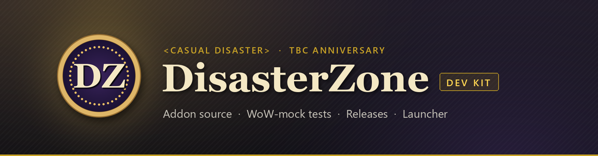

<p align="center">
  
</p>

<p align="center">
  <b>The workshop behind DisasterZone</b>, the guild addon of &lt;Casual Disaster&gt; for WoW TBC Anniversary (Interface 20506).<br>
  <sub>The addon source with everything needed to change it safely: the specs, an offline WoW-client mock, 209 test suites,
  the data generators, the release tools and the desktop launcher.</sub>
</p>

<p align="center">
  <a href="#layout">Layout</a> &nbsp;·&nbsp;
  <a href="#setup-once-or-after-deleting-devluaenv">Setup</a> &nbsp;·&nbsp;
  <a href="#everyday-commands">Everyday commands</a> &nbsp;·&nbsp;
  <a href="#making-a-change">Making a change</a> &nbsp;·&nbsp;
  <a href="#releasing">Releasing</a>
</p>

<table align="center">
  <tr>
    <td align="center" width="25%"><b>Offline WoW client</b><br><sub>A Lua 5.1 mock with guilds, raids, loot, /roll and relogs</sub></td>
    <td align="center" width="25%"><b>209 test suites</b><br><sub>run_all reruns only what a change can affect</sub></td>
    <td align="center" width="25%"><b>Signed releases</b><br><sub>Full zips, in-game updates and the launcher feed</sub></td>
    <td align="center" width="25%"><b>Desktop launcher</b><br><sub>Tauri, for Windows, macOS and Linux</sub></td>
  </tr>
</table>

<p align="center"><sub>The guild-facing documentation is <code>addon/DisasterZone/README.md</code>; members download from
<a href="https://github.com/tsumilo/DisasterZone-releases">DisasterZone-releases</a>.</sub></p>

<p align="center"></p>

## Layout

```
CDLoot-dev/
  addon/DisasterZone/   -> JUNCTION to C:\World of Warcraft\_anniversary_\Interface\AddOns\DisasterZone  (the live addon)
  addon/DisasterZone_Rooms/ -> JUNCTION to ...\AddOns\DisasterZone_Rooms  (the 3D room data, a load-on-demand addon)
  dev/
    docs/         SPEC.md + SPEC_ADDENDUM_A..H.md (design), research/ (api.md = verified 2.5.6 API notes),
                  impl/ (per-phase implementation, fix and review reports)
    tools/        check.py (static checker), harness.py + wowmock/ (Lua 5.1 mock WoW client), README.md,
                  release.py + patchlib.py (full releases, signed in-game updates), patched_run.py,
                  launchlib.py (the launcher's signed release lists), readme_art.py (this README's art)
    tests/        209 scenario suites in 50 areas: tests/<area>/test_*.py
    tf_e/         run_all.py (runs every suite in parallel; output goes to tf_e/<name>/, git-ignored)
    generators/   gen_cdloot_data.py (raids), gen_cdloot_dungeons.py, gen_cdloot_sources.py
                  (crafted/rep/badges/PvP), gen_itemclasses.py (class-restricted items), gen_atlas.py (the Atlas
                  tab: every other AtlasLoot TBC table, item names, recipes), reports, validators
    find_multiret.py   scans for tonumber(<multi-return call>) hazards
    requirements.txt   lupa==2.8 (real Lua 5.1 inside Python)
  launcher/       the DisasterZone Launcher (Tauri: Rust in src-tauri/, the window in ui/); see launcher/README.md
  .github/readme/ the art at the top of this file
```

### The addon junction
`addon/DisasterZone` is a Windows directory junction pointing at the real addon folder in the game directory. That gives one set of files:
- the game loads it;
- the tools and tests read it;
- git tracks it here.

No `.git` or dev files end up in the AddOns folder you share with the guild.

`addon/DisasterZone_Rooms` is the same kind of junction, for the second addon folder: the 3D rooms, their stand-ins and the Raid Trainer's floors (dev/generators/gen_rooms.py, gen_standins.py, gen_trainer_heights.py write there). DisasterZone loads it on demand (Render3D/Rooms.lua R3.LoadData); `release.py full` zips both folders, and room changes never travel as an in-game update.

**Warning:** delete a junction with `rmdir addon\DisasterZone` (cmd) only. Never use a recursive delete (Explorer "delete", `rm -rf`, `Remove-Item -Recurse`): those can follow the junction and **delete the real addon**.

If the junction is ever missing, recreate it (PowerShell):
```
New-Item -ItemType Junction -Path C:\Users\emilo\CDLoot-dev\addon\DisasterZone -Target "C:\World of Warcraft\_anniversary_\Interface\AddOns\DisasterZone"
New-Item -ItemType Junction -Path C:\Users\emilo\CDLoot-dev\addon\DisasterZone_Rooms -Target "C:\World of Warcraft\_anniversary_\Interface\AddOns\DisasterZone_Rooms"
```

<p align="center"></p>

## Setup (once, or after deleting `dev\luaenv`)
Run from `C:\Users\emilo\CDLoot-dev\dev`:
```
python -m venv luaenv
luaenv\Scripts\python.exe -m pip install -r requirements.txt
```

<p align="center"></p>

## Everyday commands
Run everything from `C:\Users\emilo\CDLoot-dev\dev`:

| What | Command |
|---|---|
| Static check (syntax, stray globals, unknown APIs) | `luaenv\Scripts\python.exe tools\check.py` |
| Test suites (only what your change can affect) | `luaenv\Scripts\python.exe tf_e\run_all.py` |
| What that would run, and why | `luaenv\Scripts\python.exe tf_e\run_all.py --dry-run` |
| Every suite, no skipping | `luaenv\Scripts\python.exe tf_e\run_all.py --all` |
| Fail fast while fixing (last failures first, nothing new starts after a failure) | `luaenv\Scripts\python.exe tf_e\run_all.py -x` |
| One suite | `luaenv\Scripts\python.exe tests\loot-roll\test_rolls.py` (add `-k name` to run cases matching `name`) |
| Harness self-test | `luaenv\Scripts\python.exe tools\test_harness_selftest.py` |
| Multi-return hazard scan | `luaenv\Scripts\python.exe find_multiret.py` |
| Regenerate the dungeon or sources data | `luaenv\Scripts\python.exe generators\gen_cdloot_dungeons.py` / `gen_cdloot_sources.py` (they write into `addon\DisasterZone\Data\`) |
| Regenerate the Atlas tab's data | `luaenv\Scripts\python.exe generators\gen_atlas.py` (writes `Data\Atlas.lua`; run it again after changing Items, Dungeons or Sources, for the names) |

`tools\README.md` documents the mock client (World / Client, the guild and raid simulation, loot, `/roll`, relog). Use it to write new scenarios.

### How run_all stays fast
- **Fork per case in WSL.** Most suites run inside the WSL distro Ubuntu-26.04, where `tools\forkrun.py` runs a
  set-up several cases share (`r = setup()`) once and forks a clean process per case from it: such suites run 2-4x
  faster (a whole run ~20% at 8 workers, as many suites' time is in their cases), and cases can no longer leak into
  each other. Patch, launcher and scale suites stay on Windows; `--windows` runs everything there. Set-up and details: `dev\tools\wsl\README.md`. When writing a test, put the shared
  world-building first in the case and per-case tweaks after it.
- **Only what changed.** Every suite records what it depended on (`dev\.testmap\`, git-ignored): the files it
  read (its test file, helpers, harness, mock, generators, the TOC) and the addon functions its clients called.
  `run_all.py` skips a suite when nothing of that changed since its last run. An edit inside a function reruns
  the suites that called it (for a nested function, only the suites that called that function). An edit to a data
  table (`ns.Data.X = {...}`, `ns.CHANGELOG`, also `a.X, a.Y = 1, 2`) reruns the suites that called a function
  reading `X`; so does a top-level `for`/`while`/`do`/`if` block that only fills tables (`S.HEX[k] = ...`).
  Other top-level code (outside every function: event registrations, calls into the addon or the game) reruns
  every suite that loaded the file, so keep load-time code to table set-up where you can. Comments, blank lines
  and a new function nobody calls yet rerun nothing. A suite that failed and whose inputs did not change is listed
  as failed again, with its old output, without being rerun.
  Files are hashed when a suite reads them, so editing while suites run is fine: a suite that read the old version
  simply runs again next time (its record is kept).
  Use `--all` before a release, or when something outside the repo changed (date-dependent code, the Python
  install). `tools\test_testmap.py` checks the selection itself.
- **Bytecode cache.** The harness compiles each addon file once (`dev\.luacache\`), the mock's own files too.
  Clients after that load the bytecode, which makes a client boot about 5x faster. `DISASTERZONE_NO_BCCACHE=1`
  turns it off.
- **Cheap boots.** The Lua collector is paused while a client boots and runs one full cycle after the login events
  (collecting while the heap grew was a quarter of a boot), and file times come from one folder listing per boot
  instead of a stat per file. A client boot is ~0.1 s, a 7-client raid set-up ~1 s.
- **Mock timers** remember the earliest due time, so a step with nothing due skips the scan of every C_Timer.
- **Scheduling.** Longest suites first (`tf_e\timings.json`), the longest ones split into shards (`SHARDS` in
  `run_all.py`, `DZ_SHARD=i/n`), and one shared set of worker slots for every `run_all` on the machine
  (`DZ_TEST_SLOTS`, default 8: more workers only slow each suite down), so parallel agents share the CPU instead
  of each starting a full set.
- **Patch suites** hard-link their copies of the addon tree, because a fresh copy costs a virus scan on every
  first read. Never write *into* a file of such a copy: use `_patchkit.write()` / `release._put()`, which replace
  the file.

<p align="center"></p>

## Making a change
1. Edit the addon under `addon\DisasterZone\`. This is the same folder as the game's AddOns folder.
2. Run `tools\check.py` and `tf_e\run_all.py` (it runs only the suites your change can affect), and add a test for any bug you fix.
3. Test it in game with `/reload`. Paste any BugSack error into the next Claude session.
4. Bump `## Version` in `DisasterZone.toc` when you ship to the guild (see Releasing). A new Lua file needs the line-1 guard: `tools\release.py guards add`.
5. Commit here: `git add -A && git commit -m "..."`.

**Mock fidelity lesson.** The only bug that reached the game so far was a mock/real API mismatch: `GetInventoryItemID` returns 2 values in the real client, and the mock returned 1. Whenever the real client disagrees with the mock, fix the mock first, then the addon.

<p align="center"></p>

## Releasing

A change reaches the guild through a full release (the launcher installs it) or an in-game update.
`dev/docs/HOTPATCH.md` has the in-game details, the edge cases and how to turn that feature off; `launcher/README.md`
explains the launcher side.

| What | Command (from `dev`) | Members do |
|---|---|---|
| Full release | bump `## Version`, `luaenv\Scripts\python.exe tools\release.py full --publish` (`--channel beta` for testers first) | nothing: the launcher installs it (or they download the zip from the releases repo) |
| Full release, publish later | `release.py full`, try the zip, then `release.py publish` | as above |
| In-game update | bump `## Version`, `luaenv\Scripts\python.exe tools\release.py patch`, in game `/reload` + `/dz publish` | click Reload when the popup appears |
| Launcher release | raise the version in `launcher/src-tauri/tauri.conf.json`, `Cargo.toml` and `package.json`, then `release.py launcher-push` | nothing: the launcher updates itself |

- Share the zip that `release.py full` writes, never a zip of the live folder: only the packaged copy has the build
  id that in-game updates are matched against.
- An in-game update carries Lua files only. `release.py patch` refuses anything else (TOC header, libraries, the boot
  files) and tells you to make a full release. Art travels only as a full release; raise `assetPack` in
  `Core\BuildInfo.lua` and gate the code with `ns:HasAssets(n)` so the code can still go out in game.
- Every patchable file keeps its guard on line 1 (`release.py guards check`; `guards add` after creating a file).
- The signing keys live in `dev\keys\` and are git-ignored, so back that folder up somewhere safe:
  `patch_key.json` (in-game updates), `launcher_key.json` (the launcher's release lists), `updater.key` +
  `updater_password.txt` (the launcher's own updates; also secrets of the releases repo). Losing one means a full
  release with a new key, or, for the launcher keys, every member reinstalling the launcher by hand.
- Before publishing a large update: `luaenv\Scripts\python.exe tools\patched_run.py` runs every suite with the
  whole addon delivered through the update path.
- Before any release: `luaenv\Scripts\python.exe tf_e\run_all.py --all` (no skipping). It is also the only run that
  includes the release-only suites (`RELEASE_ONLY` in `tools\testmap.py`: the 60-member scale suite, a few minutes
  per case). A normal run lists them when they are due; `release.py full` / `patch` warn while they are not green.

Read `addon\DisasterZone\NOTICE.md` before sharing outside the guild. The data files are generated from GPL v2 AtlasLoot data.

<p align="center">
  <br>
  <br>
  <sub>Made for &lt;Casual Disaster&gt;</sub>
</p>
